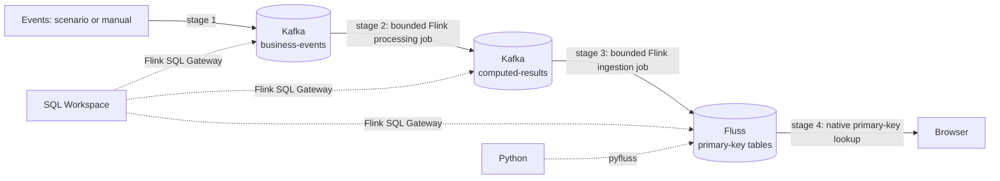

# Payment Risk Streamhouse Demo

A self-contained, button-driven demo of **Apache Kafka, Apache Flink and Apache Fluss**. One
command starts the services; four stages, each started with a button, show what each technology
does. Every result on the screen comes from the running infrastructure.



> **What is real and what is generated.** Kafka, Flink, the Flink SQL Gateway and Fluss are real
> services in Docker Compose. The business events are generated; the beneficiary change is a
> CDC-shaped record, but no database or CDC connector is deployed. Payment review uses a
> deterministic rule. **Nothing is ever paid, authorized or released.** All names, devices and
> accounts are synthetic.

## Quick start

Requirements: Git, Docker Engine or Docker Desktop, and Docker Compose v2 or newer. No host
Java, Maven, Kafka, Flink or Python installation is required. Allow **4 CPUs, 8 GB of available
RAM and 15 GB of free disk** for the stack and image builds. The tested platform is Linux
amd64; on Windows use Docker Desktop with WSL2 and Linux containers. ARM / Apple Silicon has
not been verified.

Clone this public repository and enter its root:

```bash
git clone https://github.com/vivek1kadavergu/streamhouse_fluss_demo.git
cd streamhouse_fluss_demo
```

Start the entire playground with **one command**:

```bash
docker compose up --build -d
```

The first build downloads images, Maven dependencies, the Flink Kafka SQL connector and the
Python client; internet access is required during that build. Allow several minutes for the
first startup. Open **http://localhost:8090** and wait for Kafka, Flink and Fluss to become ready
in the status bar. The page can appear before initialization has finished.

Nothing processes business events until you press a button: the bootstrap only creates
the topics and tables. Refreshing the page shows the current run's actual progress and never
repeats an operation.

| | |
| --- | --- |
| Demo UI | http://localhost:8090 (bound to 127.0.0.1 only) |
| Flink UI | http://localhost:8081, linked from every job ID |
| Stop, keeping data | `docker compose down` |
| Stop and delete **only this demo's** volumes | `docker compose down --volumes` |

If a port is already occupied, start with alternate ports (Bash / WSL):

```bash
DEMO_UI_PORT=18090 FLINK_UI_PORT=18081 docker compose up --build -d
```

Then open http://localhost:18090. Compose uses the project name
`payment-risk-streamhouse-demo`; its named volumes and network belong to this playground.
To run a second isolated instance, also pass `-p another-project-name` to every Compose command.

## The four stages

Each stage has controls on the left and live evidence on the right. A stage's button is enabled
only when the previous stage has succeeded; the next required action is highlighted.

| Stage | Button | What actually runs | Evidence shown |
| --- | --- | --- | --- |
| **1 · Events — Kafka** | Emit scenario events | The app's producer sends the four scenario events to `business-events` (acks=all, idempotent). | Each event's type, business time, event ID, supplier, partition and acknowledged offset; sending / acknowledged / failed; the exact JSON. |
| **2 · Job Execution — Flink** | Run Flink processing | A **bounded** Flink job over this run's captured input offsets `[start, end)`. It correlates the events in keyed state, evaluates the payment rule and writes computed results to `computed-results`. | Job ID (linked to the Flink UI), job state, input/output offset ranges, Flink accumulators, the supplier context versions v1→v2→v3 with changed fields highlighted, the payment review with every condition and its evidence. All read back from `computed-results`. |
| **3 · Ingestion — Fluss** | Ingest results into Fluss | The app validates this run's computed results against the `computed-result/v1` contract, then submits a **bounded** Flink ingestion job that writes them through the official Fluss connector. | Job ID and state, source range, records by producer, rejected records with reasons, supplier versions stored, and a **native Fluss read-back of every row**. Persistence is claimed only when every row matches. |
| **4 · Query Results — Fluss** | Query Fluss | Two native primary-key lookups (`supplier_risk`, `payment_reviews`) through the Fluss Java client. This is not SQL. | Context version, source event references, bank-change time, unfamiliar-device evidence, risk status, review outcome, lookup duration, queried-at time and the raw response. |

Fluss never runs the computation: the ingestion button starts the job that writes the computed
results into Fluss. Between stages 2 and 3 the results exist only in Kafka, and the final tables
for the run are empty; the acceptance test checks this.

**Bounded executions, not an always-on pipeline.** Each job reads exactly the offset range
captured when you press the button, then finishes. Records that arrive later are excluded from that
execution and are picked up when you run the stage again. Processing and ingestion run one at a
time, so they do not compete for task slots.

**Runs.** *Start new demo* creates a fresh run ID. Topics and tables are kept; the four-stage
workflow processes and looks up the current run's records. The workspaces can also query records
from earlier runs: include a `run_id` filter when you want only the current run. Only one stage
operation runs at a time; a second submission gets HTTP 409.

## The scenario: The $75,000 Payment That Looked Legitimate

ABC Company has paid Northstar Logistics for three years: routine USD 75,000 payments to the
beneficiary account ending 1842.

| Business time (UTC) | Event | Supplier context after Flink |
| --- | --- | --- |
| 10:00 | Supplier baseline | v1, risk NORMAL |
| 10:01 | Beneficiary changes to the account ending 9077 (`CHG-1001`, actor, session) | v2, ELEVATED: identity evidence pending |
| 10:02 | Identity activity links that exact change (same change, session and actor) to a previously unseen device | v3, HIGH |
| 10:03 | USD 75,000 payment request | `payment_reviews`: **MANUAL_REVIEW**, evaluated against context v3 |

### Supplier signals and payment decisions

The supplier's `signal_band` describes the latest observed evidence. It is separate from the
payment's `outcome`:

- **NORMAL:** no beneficiary change has been observed.
- **ELEVATED:** a beneficiary change has been observed without matching unfamiliar-device evidence.
- **HIGH:** the change has matching unfamiliar-device evidence. HIGH indicates suspicious
  evidence; it does not by itself determine the payment decision or confirm fraud.

The baseline records the supplier's recurring payment amount; it does not introduce a separate
scheduled-payable event. The full payment rule checks the actual request's amount and business
time when the payment request is processed:

```text
recent_change     = 0 <= payment.occurred_at - bank_change.occurred_at <= 10 minutes
unfamiliar_device = identity activity matched to that change (change_id, actor_id, session_id)
                    AND device_is_known == false
                    AND identity.occurred_at <= payment.occurred_at
large_payment     = currency == USD AND amount_minor > 5_000_000      (cents)

MANUAL_REVIEW if all three are TRUE
```

Each condition is TRUE, FALSE or UNKNOWN. Required evidence takes precedence over a rule match:

| Condition | Outcome |
| --- | --- |
| Supplier baseline is missing, or a recent change lacks linked identity evidence | `REVIEW_INCOMPLETE_CONTEXT` |
| Required evidence is available and all three rule conditions are TRUE | `MANUAL_REVIEW` |
| Required evidence is available and the three-condition rule does not match | `NO_RULE_MATCH` |

`NO_RULE_MATCH` means this rule did not match; it is not payment approval. The review records
the context version it used, the rule parameters and the event IDs of its evidence. The
ten-minute window and USD 50,000 threshold are this application's policy settings, not built-in
Flink or Fluss rules.

There is **no automatic ten-minute expiry timer** for the supplier signal band. The payment rule
compares the payment's event time with the bank change's event time each time it evaluates a
request. A stored HIGH band can therefore remain HIGH while a later payment does not match the
recent-change condition.

The 10:00–10:03 sequence describes business event time. `updated_at` and `evaluated_at` record
actual Flink processing time; they need not match the story clock. Neither a context version nor
an update timestamp alone proves that all source events have been processed.

Implementation: [supplier signal bands](common/src/main/java/demo/paymentrisk/common/correlation/SignalBand.java),
[payment rule](common/src/main/java/demo/paymentrisk/common/rule/PaymentReviewRule.java),
[scenario events](scenarios/01-northstar-suspicious.json).

The UI has exactly one scenario. Negative cases (known device, unrelated change, amount exactly
USD 50,000, stale change, missing identity, out-of-order identity, duplicate delivery) are kept as
test fixtures in `scenarios/` and run in the unit tests.

### Stored results and queries

Stage 3 writes three **primary-key tables** in the default Fluss database, `payment_risk`:

| Table | Primary key | Contents |
| --- | --- | --- |
| `supplier_risk` | `(run_id, supplier_id)` | Latest supplier context, `signal_band`, version and source evidence |
| `payment_reviews` | `(run_id, payment_id)` | Deterministic outcome, condition checks and evidence used |
| `event_receipts` | `(run_id, event_id)` | Processing disposition and provenance for each event |

The built-in flow does not create a Fluss log table. Kafka retains the input events and computed
results according to its retention configuration; Fluss maintains the keyed output rows.

After ingestion succeeds, select **Query Workspace → SQL → batch**. Its generated point-query
examples already contain the current run ID. For the default Northstar scenario, the equivalent
queries below use the actual table and field names; replace `<run_id>` with your current run ID:

```sql
SELECT supplier_id, signal_band, context_version,
       bank_change_occurred_at, updated_at
FROM fluss_catalog.payment_risk.supplier_risk
WHERE run_id = '<run_id>' AND supplier_id = 'SUP-NORTHSTAR';
```

```sql
SELECT payment_id, outcome, check_recent_change,
       check_unfamiliar_device, check_large_payment,
       context_version_used, explanation
FROM fluss_catalog.payment_risk.payment_reviews
WHERE run_id = '<run_id>' AND payment_id = 'PAY-NS-0001';
```

Run one statement at a time. SQL is executed by Flink through the SQL Gateway; Fluss supplies
the stored data. Stage 4 instead uses the native Java client, and the Python workspace uses
pyfluss. Full columns and keys: [table schemas](common/src/main/java/demo/paymentrisk/common/TableSchemas.java).

### Architecture scope

The included path is **Kafka → Flink processing → Kafka results → Flink ingestion → Fluss**.
The deterministic payment decision is computed in the processing job, before Fluss ingestion;
it is not a separate service reading Fluss to authorize a payment.

Real database CDC, an always-on processing deployment, lakehouse tiering and historical lakehouse
queries require additional integrations. They are not started by this repository's Compose
command. The displayed explanation uses a fixed template populated from recorded evidence.
This playground never authorizes or releases payments.

## Workspaces

Below the stages, four tabs hold the editors and execution details.

- **Events.** A manual producer: topic selector (`business-events` or `playground-events`),
  message key, JSON editor with formatting and validation, batch mode (JSON array or one object
  per line), and the producer acknowledgment (partition, offset, timestamp) for every record.
  Templates: simple JSON event, supplier baseline, beneficiary change, identity activity, payment
  request. Records for `business-events` must satisfy the business-event v1 contract and are
  rejected with the reasons before anything is sent. `playground-events` takes any JSON object.
  Manual business events of the current run follow the same Kafka → Flink → Fluss path.
- **SQL Workspace.** Flink SQL executed by the **Flink SQL Gateway** on the same Flink cluster.
  Predefined tables: `business_events`, `playground_events`, `computed_results` (Kafka) and the
  `fluss_catalog` (Fluss). Working examples read, filter, select, aggregate and write. SELECT
  returns rows; `INSERT INTO computed_results` creates a job whose output stage 3 ingests (after
  validation). Batch mode is bounded and finishes; streaming mode runs until cancelled. Every
  execution shows its Flink job ID, state, columns, rows, duration, errors and the raw gateway
  response, and can be cancelled.
- **Query Workspace.** *SQL*: Flink SQL against the Fluss tables through the Fluss connector
  (point queries, limits, counts, aggregates, streaming changelog). *Python*: editable code run
  with **pyfluss 1.0.0**, the official Fluss Python client, in an isolated container; it shows
  stdout, stderr, exit code and duration.
- **Execution History.** Every operation: stage operations, manual sends, SQL statements and
  Python runs, with status, duration and Flink job links.

## Components

| Service | Role |
| --- | --- |
| `kafka` | Apache Kafka 3.9.1, one broker + controller (KRaft). Topics `business-events`, `computed-results`, `playground-events`, 1 partition each. |
| `zookeeper` | Coordination for Fluss only. |
| `fluss-coordinator`, `fluss-tablet` | Apache Fluss 1.0.0: one coordinator and one TabletServer. |
| `flink-jobmanager`, `flink-taskmanager` | Flink 1.20 session cluster, 4 task slots. Runs only jobs that were requested. |
| `flink-sql-gateway` | Flink SQL Gateway (REST v2) for the SQL and Query workspaces. |
| `python-runner` | Isolated Python execution with pyfluss 1.0.0. |
| `bootstrap` | One-shot: creates topics and Fluss tables. Never emits events or submits jobs. |
| `demo-app` | Stage orchestration, producer, native Fluss lookups, workspaces, SSE and UI. |

Details: [docs/architecture.md](docs/architecture.md).

## Security model

Locally, the UI is bound to 127.0.0.1 and the playground needs no login. Before exposing it
anywhere else:

- Set `PLAYGROUND_ACCESS_TOKEN`. SQL and Python execution then require
  `Authorization: Bearer <token>`; the UI asks for the token.
- Python runs in `python-runner`: no host mounts, no Docker socket, read-only root filesystem,
  32 MiB tmpfs, 768 MiB memory, 128 PIDs, 1 CPU, all capabilities dropped, non-root user. Its
  only network is an internal one that reaches Fluss and the demo app (no internet, no Kafka, no
  Flink). Each execution has a wall-clock limit (20 s by default), a CPU limit, a 1 MiB file-size
  limit and a 64 KiB output cap, and runs one at a time. For a multi-user public deployment, run
  one runner per user or session instead of the shared one.
- SQL is limited to the predefined tables: one statement at a time; SELECT, EXPLAIN, SHOW,
  DESCRIBE and `INSERT INTO computed_results` only; no DDL, `SET`, `ADD JAR` or connection options
  in hints. Statements have a timeout, a 500-row result limit and at most two run at once.

## Tested compatibility matrix

| Component | Version (pinned) |
| --- | --- |
| Apache Kafka (broker image) | `apache/kafka:3.9.1` @ `sha256:4ceccc57…` |
| ZooKeeper (for Fluss) | `zookeeper:3.9.2` @ `sha256:43d39109…` |
| Apache Fluss server | `apache/fluss:1.0.0` @ `sha256:ff461b45…` |
| Apache Flink + Fluss connector | `apache/fluss-quickstart-flink:1.20-1.0.0` @ `sha256:70e67eee…`: Flink **1.20.0**, `fluss-flink-1.20-1.0.0.jar` |
| Flink Kafka SQL connector | `flink-sql-connector-kafka-3.3.0-1.20.jar`, added to the Flink image with a SHA-256 check |
| Flink SQL Gateway | bundled with Flink 1.20.0 (`/opt/flink/opt/flink-sql-gateway-1.20.0.jar`) |
| Fluss Java client (app) | `org.apache.fluss:fluss-client:1.0.0` |
| Fluss Python client | `pyfluss 1.0.0` on `python:3.12-slim` @ `sha256:5e2bdb1b…` |
| Kafka client (app) | `kafka-clients 3.9.1` |
| Build / runtime JDK | Maven 3.9.9 + Temurin 17 / `eclipse-temurin:17-jre` |
| Docker | Engine 29.8.1, Compose v5.5.1 (Docker Desktop, WSL2) |
| Platform tested | **linux/amd64 only.** ARM / Apple Silicon is not tested. |

Full digests: [THIRD_PARTY_ASSETS.md](THIRD_PARTY_ASSETS.md).

## Tests

| Layer | What | How |
| --- | --- | --- |
| Unit | Rule truth table and boundaries, correlation engine, every scenario fixture (including the negative cases), the computed-result contract, SQL guard rails, sink SQL | `docker build --target test -f docker/app/Dockerfile .` |
| End-to-end | Real services. Operations are started through the app's HTTP API; results are checked in the app state **and** independently with the verifier's own Kafka reads, Flink REST calls and native Fluss lookups. Phases: `stages`, `playground`, TaskManager down/recovered, TabletServer down/recovered, Kafka down/recovered. | `bash scripts/smoke.sh` → `build/smoke/` |

No mocked integration tests.

**Latest results:** see [Verification status](#verification-status).

## Verification status

**Public checkout verified on 2026-11-15** (Docker Desktop on WSL2, linux/amd64):

- The documented Compose startup command built and started a separate project with fresh
  volumes on alternate ports. Kafka, Flink, Fluss, SQL Gateway and the Python runner all reported ready.
- **31 unit tests passed**, with the test stage rerun without its cached result. An interrupted
  Maven Central dependency download required one retry.
- **27 HTTP acceptance checks passed** against the actual services: stage gating, Kafka
  acknowledgments, processing and ingestion job completion checked through Flink REST, no Fluss
  rows before ingestion, all six expected rows matching read-back, context v3 / HIGH,
  MANUAL_REVIEW with three TRUE conditions, execution provenance, manual events, Flink SQL over
  Kafka, Fluss SQL and native pyfluss reads, and refresh preserving the result.
- Gitleaks 8.30.1 and a separate review of machine paths and identifiers found no credentials
  or private machine paths in the publication files. Runtime data, logs, credentials,
  environment files and local workspace settings are excluded from Git.

These publication checks cover startup and the working data path. The broader fault/recovery
suite below records the previous maintainer run; it was not rerun as part of the publication check.

### Earlier maintainer baseline

Run on 2026-11-13/14 against the real Docker services (Docker Desktop on WSL2, linux/amd64).
Local logs are generated in `build/smoke/` and are deliberately excluded from Git. New CI runs
publish their logs as GitHub Actions artifacts; the figures below record the earlier local run.

**Unit tests:** 31 passed, 0 failed, on the final code (26 in `common`, 2 in `flink-job`, 3 in
`demo-app`).

**End-to-end, from clean volumes** (`bash scripts/smoke.sh`): **86 passed, 0 failed** in 481 s.
The four stages were verified 191 s after `docker compose up --build -d`.

| Phase | Checks | What it proves |
| --- | --- | --- |
| `stages` | 34 / 34 | Nothing runs on startup. Stages 2–4 are locked until stage 1, and duplicate submissions get HTTP 409. Stage 1: 4 events acknowledged at consecutive offsets, confirmed by an independent Kafka read, with no Fluss rows. Stage 2: the processing job reaches FINISHED in Flink REST and reads exactly this run's 4 records. The context evolves v1→v2→v3 and the review is MANUAL_REVIEW with 3 TRUE checks against v3. The final Fluss tables are still empty. Stage 3: the ingestion job reaches FINISHED and all 6 rows are read back. Stage 4: native lookups return MANUAL_REVIEW. A refresh repeats nothing, and a new run ID starts with no stale rows. |
| `playground` | 29 / 29 | A manual batch is acknowledged and readable at its offsets. Invalid JSON and contract-violating events are rejected with reasons. Two SQL queries (aggregate, filter) return different, correct results as Flink jobs. Parse errors and refused DDL are reported. Cancelling a streaming query cancels its Flink job. A late event is excluded from the first bounded run and included in the next. SQL `INSERT` output is ingested, and an incompatible row is rejected with the reason. Flink SQL and Python (pyfluss) both read Fluss rows. A Python syntax error is reported, and a Python run can be cancelled. |
| `tm-down` / `tm-recovered` | 5 / 5, 6 / 6 | With the Flink TaskManager stopped, stage 2 fails with a TaskManager message and no Fluss rows are written. After restart, all four stages succeed. |
| `fluss-down` / `fluss-recovered` | 5 / 5, 5 / 5 | With the TabletServer stopped, stage 2 still succeeds (it writes to Kafka). Stage 3 fails with a Fluss message, and stage 4 is refused. After restart, retrying stage 3 succeeds and the outcome is MANUAL_REVIEW. |
| `kafka-down` / `kafka-recovered` | 2 / 2, 2 / 2 | With Kafka stopped, stage 1 fails ("Kafka is not reachable, so no event was sent") and stage 2 stays locked. After restart, retrying stage 1 succeeds. |

In that run, the `kafka-down` phase crashed before its checks. While the container is stopped its
Compose DNS name does not resolve, and the Kafka client could not be created. The app and the
verifier now create their Kafka clients lazily.

**Latest run, after the speed changes** (2026-11-14, `SMOKE_FRESH=false` on the running stack,
not clean volumes): **88 passed, 0 failed** in 349 s, including both Kafka phases. The `stages`
phase took 23 s, down from 70 s.

**Stage durations** (warm cluster, measured by the app; each stage's *Timing* panel shows its
steps):

| Stage | Duration | Where the time goes |
| --- | --- | --- |
| 1 · Events | ~0.5 s | Kafka acks take 3–20 ms; the rest is the 150 ms display pause between events (`DEMO_EMIT_PACE_MS`) |
| 2 · Job Execution | 1.1–1.7 s | ~0.35 s job submission (planning in the JobManager), 0.65–1.2 s job run |
| 3 · Ingestion | 6–8 s | ~1.7 s submission (planning + Fluss catalog), 3.8–6 s job run. About 2 s of the run is the Fluss client's network shutdown when the job ends, which the connector does not let us configure |
| 4 · Query Results | < 0.1 s | Two native lookups, run concurrently |

The first job after the Flink cluster starts is slower (up to ~12 s to submit) while the jar is
uploaded and the planner warms up.

**Resources:** about 3.6 GiB of RAM across the 9 running containers, sampled after the
`playground` phase.

**Not yet verified:** the UI has not been visually reviewed in a browser. The API that the UI
uses passed all the checks above.

## Learn more

- [docs/walkthrough.md](docs/walkthrough.md): the four stages step by step, the intermediate
  topic, and exercises with the workspaces.
- [docs/architecture.md](docs/architecture.md): topology, jobs, contracts, failure behaviour.
- [docs/configuration.md](docs/configuration.md) and [docs/troubleshooting.md](docs/troubleshooting.md).

UI versions: the app serves `web/${DEMO_UI_VERSION}.html` at `/`; the default is **`v2`**.
Earlier versions stay in `web/` and are reachable at `/web/vN.html` (`v1` belongs to the earlier
continuous-pipeline design and no longer matches the API).

Optional Python developer playbooks: [`notebooks/`](notebooks/README.md) provides interactive
Marimo notebooks (`00_simulation.py`, `01_kafka.py`, `02_flink.py`, `03_fluss.py`) that drive the
same `demo-app` REST API alongside `web/v2.html` without replacing the default browser UI.

## Repository layout

```text
compose.yaml            all services; only 127.0.0.1:8090 and :8081 are published
common/                 event codec, table + computed-result contracts, rule, correlation engine
flink-job/              bounded processing (Kafka→Kafka) and ingestion (Kafka→Fluss) jobs
demo-app/               stage orchestration, producer, Fluss lookups, SQL/Python workspaces, UI server, verifier
web/v2.html             current UI (buildless, no CDN); web/v1.html kept
notebooks/              optional interactive Marimo Python playbooks driving the demo-app HTTP API
docker/                 app build, Flink image (+ Kafka SQL connector), python-runner
scenarios/              the Northstar scenario + negative-case fixtures for tests
schemas/                business-event JSON schema + examples
scripts/smoke.sh        end-to-end acceptance test
docs/                   architecture, walkthrough, configuration, troubleshooting
```

## Not included

Real database CDC, lakehouse tiering (Paimon/Iceberg), historical lakehouse queries, payment
execution, Kubernetes, TLS, Schema Registry, multi-partition ordering and production HA.

## License and trademarks

The original code is offered under the Apache License 2.0 ([LICENSE](LICENSE)).
Third-party logos are **not** relicensed; see
[THIRD_PARTY_ASSETS.md](THIRD_PARTY_ASSETS.md) and [NOTICE](NOTICE). Apache, Kafka, Flink, Fluss
and their logos are trademarks of The Apache Software Foundation. This is an independent project
and implies no ASF or vendor endorsement.
