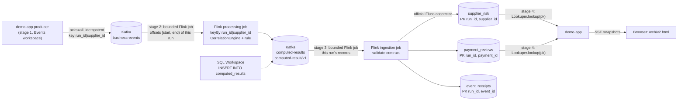

# Architecture

## Data path



All topics have one partition, so offsets give one total order and a captured range is simply
`[start, end)` on partition 0.

## Services

| Service | Image | Notes |
| --- | --- | --- |
| `kafka` | `apache/kafka:3.9.1` | One KRaft node. Advertised as `kafka:9092`, reachable only inside Compose. Auto-create off. |
| `zookeeper` | `zookeeper:3.9.2` | Used only by Fluss. |
| `fluss-coordinator`, `fluss-tablet` | `apache/fluss:1.0.0` | Listen on all interfaces and advertise their Compose DNS names (they are on two networks). KV snapshots every 30 s. |
| `flink-jobmanager` | quickstart image + Kafka SQL connector | REST/UI on `127.0.0.1:8081`. Restart strategy `none`: bounded executions fail fast. |
| `flink-taskmanager` | same | 4 slots, 1728 MB. Mounts Fluss remote storage read-only, because Flink SQL reads of primary-key tables load KV snapshot files from it. |
| `flink-sql-gateway` | same | `sql-gateway.sh start-foreground`, REST v2 on port 8083, submits to the session cluster. |
| `python-runner` | `python:3.12-slim` + pyfluss 1.0.0 | Isolated; see the README's security model. Internal network only. |
| `bootstrap` | app image, `bootstrap` | Creates the three topics and the Fluss tables. Never emits events, never submits jobs. |
| `demo-app` | app image, `serve` | UI and API on `127.0.0.1:8090`. |
| `e2e` | app image, `verify` | Only with `--profile test`. |

Networks: `default` for everything, and `python-exec` (internal) for `python-runner`, the two Fluss
servers and `demo-app`.

## The two jobs

Both are entry points of one jar (`flink-job.jar`, main class `demo.paymentrisk.flink.PaymentRiskJob`),
uploaded by the app through `POST /jars/upload` the first time it is needed, and submitted with
`POST /jars/:id/run` and program arguments. Parallelism 1, restart strategy `none`. Both read a
bounded Kafka table (`scan.startup.mode` and `scan.bounded.mode` = `specific-offsets`) through the
Kafka SQL connector in `/opt/flink/lib`, then continue in the DataStream API.

```text
processing:  business-events [start, end)  -> parse + keep run_id == this run (accumulators)
             -> keyBy(run_id|supplier_id) -> CorrelationFunction (keyed state, rule)
             -> computed-results (one record per output row, in order)

ingestion:   computed-results [start, end)  -> keep this run -> validate computed-result/v1
             -> side outputs per table -> 3 x INSERT INTO fluss_catalog.payment_risk.<table>
```

All business logic is in the plain-Java `CorrelationEngine` and `PaymentReviewRule` (`common`),
unit-tested without Flink. The contract code, `ComputedResults`, is shared by the processing job
(encoding), the app (pre-validation) and the ingestion job (validation).

Keyed state lives only for one execution: a bounded job starts empty, reads the run's whole range
and finishes. Re-running stage 2 therefore recomputes the run from its first event.

## Orchestration (demo-app)

- **One stage operation at a time.** A second submission gets HTTP 409 with the reason. Stage
  buttons are enabled only after the previous stage succeeded.
- **Captured ranges.** When a run is created (or before its first record), the app records the
  log-end offsets of `business-events` and `computed-results`. Stage 2 reads from the first of
  these to the topic's end at the moment the button is pressed; stage 3 does the same on
  `computed-results`. Every job also filters by run ID.
- **Stage 2** waits for the job to reach a terminal state (default limit 120 s; on timeout the
  job is cancelled), reads the accumulators, then reads its output range from `computed-results`
  and keeps the records with its execution ID.
- **Stage 3** validates the run's computed records, submits the ingestion job, waits for FINISHED,
  then looks up every expected row (latest record per primary key) and compares all values plus
  `computed_by` and `ingested_by`. It retries the read-back twice; only a full match is
  SUCCEEDED.
- **Stage 4** issues two lookups and shows the rows and timings.
- **State** is held on the server and pushed as SSE snapshots. A refresh or reconnect only reads
  it; GET requests never start anything.

## SQL execution

Each SQL execution opens its own SQL Gateway session (`execution.runtime-mode` batch or
streaming, restart strategy none), creates the predefined tables in the session's in-memory
catalog plus `fluss_catalog`, runs the one statement, fetches results page by page, then closes
the operation (which cancels a still-running job) and the session. Kafka tables default to
`earliest-offset` → `latest-offset`, so batch queries are bounded; a hint can make them unbounded
for streaming. An `INSERT INTO computed_results` is followed through the Flink REST API until its
job ends, and the records it wrote are read back and checked against the contract.

Fluss through Flink SQL in batch mode: full-key filters become point lookups; `LIMIT`, `COUNT(*)`
and full scans read the KV snapshot. Streaming mode reads snapshot + changelog until cancelled.

## Observability vocabulary

| Signal | What it proves |
| --- | --- |
| Kafka ack (partition, offset) | The broker durably accepted the record. |
| Flink job FINISHED + accumulators | The bounded job read and emitted those counts. |
| Records read from `computed-results` | What the processing job (or a SQL INSERT) actually wrote. |
| Rows returned by a Fluss lookup | The data is in Fluss. Stage 3 succeeds only on this. |
| Pipeline animation | Plays only when a stage reaches SUCCEEDED; it is a drawing, not a per-hop ack. |

## Failure behaviour (exercised by `scripts/smoke.sh`)

| Failure | What happens |
| --- | --- |
| TaskManager stopped | Health shows Flink DOWN. Stage 2 fails: "No Flink TaskManager is registered…". Nothing reaches Fluss. After a restart, the stages run again. |
| TabletServer stopped | Health shows Fluss DOWN. Stages 1 and 2 still work (Kafka and Flink only). Stage 3 fails with a Fluss message; stage 4 stays locked; `/api/lookup` returns 503. After a restart, stage 3 succeeds for the same run. |
| Kafka stopped | Stage 1 fails with the producer error; acknowledged events are kept and a retry sends only the rest. |
| Job does not finish in time | It is cancelled and the stage fails with the last job state. |
| Browser refresh / SSE reconnect | Shows the server's current state; nothing is re-run. |
