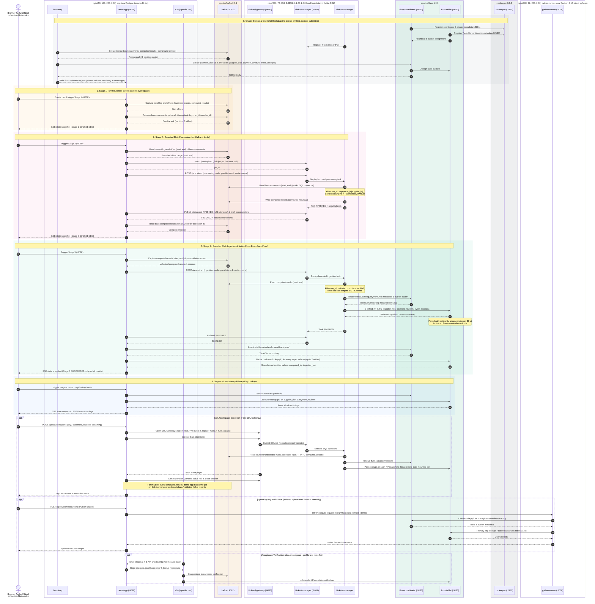

# Docker Image Interaction Architecture

Based on [docs/architecture.md](../../docs/architecture.md) and [compose.yaml](../../compose.yaml), this document illustrates the runtime interactions between the Docker images and Compose services in the **Payment Risk Streamhouse Demo**.

## Docker Images & Services

| Docker Image | Service(s) | Network(s) | Role |
| --- | --- | --- | --- |
| `payment-risk-streamhouse-demo/app:local` (`eclipse-temurin:17-jre`) | `bootstrap`, `demo-app`, `e2e` (`--profile test`) | `default` (`demo-app` also on `python-exec`) | One-shot topic/table setup (`bootstrap`), UI/API orchestrator on `127.0.0.1:8090` (`serve`), and acceptance tests (`verify`). |
| `apache/kafka:3.9.1` | `kafka` | `default` | Single-node KRaft broker (`kafka:9092`, auto-create off, 1 partition per topic). |
| `payment-risk-streamhouse-demo/flink:1.20-1.0.0-local` (`apache/fluss-quickstart-flink:1.20-1.0.0` + Kafka SQL connector) | `flink-sql-gateway`, `flink-jobmanager`, `flink-taskmanager` | `default` | SQL Gateway REST v2 (`:8083`), JobManager REST/UI (`127.0.0.1:8081`), TaskManager (4 slots, mounts `fluss-remote-data` read-only). |
| `apache/fluss:1.0.0` | `fluss-coordinator`, `fluss-tablet` | `default`, `python-exec` | Metadata/placement coordinator and TabletServer (`:9123`); persists KV snapshots every 30 s to shared `fluss-remote-data`. |
| `zookeeper:3.9.2` | `zookeeper` | `default` | Coordination service (`:2181`), used exclusively by Apache Fluss. |
| `payment-risk-streamhouse-demo/python-runner:local` (`python:3.12-slim` + `pyfluss 1.0.0`) | `python-runner` | `python-exec` (internal only) | Hardened, isolated Python execution sandbox (`:8000`) reachable only by `demo-app` and talking only to Fluss. |

## Sequence Diagram of Docker Image Interactions

## Network Boundaries

- **`default` network**: Connects `kafka`, `zookeeper`, `fluss-coordinator`, `fluss-tablet`, `flink-jobmanager`, `flink-taskmanager`, `flink-sql-gateway`, `bootstrap`, `demo-app`, and `e2e`.
- **`python-exec` network (`internal: true`)**: Connects only `demo-app`, `python-runner`, `fluss-coordinator`, and `fluss-tablet`. `python-runner` cannot reach Kafka, Flink, ZooKeeper, or external networks.
- **Shared volumes used for inter-container data exchange**:
  - `fluss-remote-data`: Written by `fluss-coordinator` and `fluss-tablet` (KV snapshots every 30 s) and mounted read-only (`:ro`) by `flink-taskmanager` for Flink SQL scans of primary-key tables.
  - `bootstrap-status`: Written by `bootstrap` (`/status/bootstrap.json`) and mounted read-only (`:ro`) by `demo-app`.
  - `flink-checkpoints`: Shared by `flink-jobmanager` and `flink-taskmanager`.
