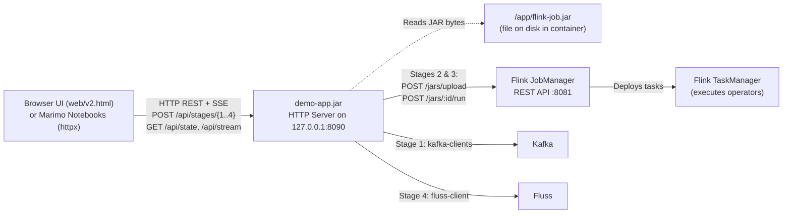

# JAR Architecture, Demo UI Interaction & Dynamic Debugging

This document explains why the **Payment Risk Streamhouse Demo** uses Java JARs, how the Demo UI (`http://localhost:8090`) and Marimo notebooks interact with those JARs, and how to dynamically debug the uploaded `flink-job.jar` during live demo execution.

---

## 1. Why Java / JARs Instead of Rust?

Choosing Java/JARs over Rust in this demo is driven by the **streaming stack's runtime requirements**, not because JARs are inherently more auditable than Rust binaries:

1. **Apache Flink requires a JVM JAR.** Stages 2 (processing) and 3 (ingestion) run on Apache Flink 1.20. Flink's job submission API (`POST /jars/upload` → `POST /jars/:id/run`) only accepts JVM `.jar` archives (`flink-job.jar`). A native Rust binary cannot be submitted to a Flink cluster.
2. **One shared source of truth (`common` module).** Because `flink-job` must be Java, keeping `common`, `flink-job`, and `demo-app` in a single Maven multi-module project ([pom.xml](../../pom.xml)) lets all components share the exact same domain logic and data contracts (`CorrelationEngine`, `PaymentReviewRule`, `ComputedResults`, `TableSchemas`) without cross-language duplication or schema drift.
3. **First-class JVM clients for Kafka, Flink, and Fluss.** All three core infrastructure services are JVM-based. `demo-app` uses `org.apache.fluss:fluss-client:1.0.0` and `org.apache.kafka:kafka-clients:3.9.1` directly ([demo-app/pom.xml](../../demo-app/pom.xml)), compiled in one Docker build stage ([docker/app/Dockerfile](../../docker/app/Dockerfile)).
4. **Auditability in banking (context).** While JVM bytecode in a JAR is easier to inspect or decompile than a stripped native binary, banks do not rely on decompiling production binaries for auditability. Regulated environments rely on source control, code review, reproducible CI builds, SBOM/CVE scanning, artifact signing, and runtime provenance/audit trails (such as `event_receipts`, `computed_by`, and `ingested_by` in this demo).

---

## 2. How the Demo UI (`http://localhost:8090`) Interacts with the JARs

The `demo-app` container image ([docker/app/Dockerfile](../../docker/app/Dockerfile)) packages **two JARs**:

- `/app/demo-app.jar` (+ `/app/lib/*`) — **runs the Demo UI and REST API server itself** (`java -cp /app/demo-app.jar:/app/lib/* demo.paymentrisk.app.Main serve`).
- `/app/flink-job.jar` — sits on disk inside the `demo-app` container and is **uploaded to Apache Flink over HTTP** on demand.



### Browser UI & Marimo Notebooks → `demo-app.jar`
- [WebServer.java](../../demo-app/src/main/java/demo/paymentrisk/app/web/WebServer.java) runs Java's built-in `HttpServer` on port `8090` (published only to `127.0.0.1:8090`).
- **Browser UI (`web/v2.html`)**: `GET /` serves `web/v2.html`. Button clicks invoke `POST /api/runs`, `POST /api/stages/{1..4}`, `POST /api/events`, `POST /api/sql/executions`, and `POST /api/python/executions`. Live progress streams back via Server-Sent Events (`GET /api/stream`).
- **Marimo Notebooks ([notebooks/README.md](../README.md))**: The Python playbooks never touch any JAR directly. `StreamhouseClient` ([notebooks/shared/client.py](../shared/client.py)) sends HTTP requests via `httpx` to `http://localhost:8090` (`STREAMHOUSE_APP_URL`) and polls `GET /api/state`.

### `demo-app.jar` → `flink-job.jar` (Stages 2 & 3)
`flink-job.jar` is never executed inside `demo-app`'s JVM. When Stage 2 or Stage 3 is triggered, `RunManager` uses [FlinkRest.java](../../demo-app/src/main/java/demo/paymentrisk/app/infra/FlinkRest.java) to drive Flink's REST API (`http://flink-jobmanager:8081`):
1. **Check / Upload**: Calls `GET /jars`. If `flink-job.jar` is not yet uploaded, it sends `/app/flink-job.jar` as multipart form-data via `POST /jars/upload`.
2. **Submit**: Calls `POST /jars/:id/run` with CLI arguments specifying the mode (`processing` or `ingestion`), `run_id`, and bounded Kafka offset range `[start, end)`.
3. **Track & Verify**: Polls `GET /jobs/:id` and `GET /jobs/:id/accumulators` until `FINISHED`, then reads back the outputs (from Kafka for Stage 2, or via native Fluss lookups for Stage 3).

*(Stages 1 and 4 do not use `flink-job.jar`: Stage 1 produces to Kafka via `kafka-clients`, and Stage 4 queries Fluss directly via `fluss-client`.)*

---

## 3. How to Dynamically Debug the Uploaded `flink-job.jar`

### Know Which JVM Runs Which Code
When `flink-job.jar` is executed by Flink, its code runs across **two different containers/JVMs**:

| Container / JVM | What executes there | Typical classes to debug |
| --- | --- | --- |
| **`flink-jobmanager`** | `main()` method, Table/SQL planning, job graph compilation (`POST /jars/:id/run`) | `demo.paymentrisk.flink.PaymentRiskJob`, `JobArgs`, `KafkaTables`, `FlussSinks` |
| **`flink-taskmanager`** | Actual per-record stream operators & business logic | `demo.paymentrisk.flink.CorrelationFunction`, `BusinessEventDeserializer`, `ComputedResultRouter`, `demo.paymentrisk.common.correlation.CorrelationEngine`, `demo.paymentrisk.common.rule.PaymentReviewRule` |

> **Important timeout note:** `demo-app` cancels any Stage 2/3 Flink job that exceeds `STAGE_JOB_TIMEOUT_MS` (default `120000` ms = 2 minutes in [compose.yaml](../../compose.yaml)). When stepping through breakpoints, raise `STAGE_JOB_TIMEOUT_MS` (e.g., `600000` = 10 minutes) so `demo-app` does not cancel the job mid-debug.

---

### Option A: Remote JDWP Breakpoints (IDE or `jdb`)

Use a temporary Compose override file (e.g. `compose.debug.yaml`) to enable JDWP on the Flink JVMs without modifying `compose.yaml`. Use `env.java.opts.taskmanager` / `env.java.opts.jobmanager` inside `FLINK_PROPERTIES` so you do not overwrite `JAVA_TOOL_OPTIONS` if `compose.override.yaml` is active.

```yaml
# compose.debug.yaml (temporary local file — do not commit)
services:
  flink-taskmanager:
    ports:
      - "127.0.0.1:5005:5005"
    environment:
      FLINK_PROPERTIES: |
        jobmanager.rpc.address: flink-jobmanager
        taskmanager.numberOfTaskSlots: 4
        taskmanager.memory.process.size: 1728m
        state.checkpoints.dir: file:///flink-checkpoints
        env.java.opts.taskmanager: -agentlib:jdwp=transport=dt_socket,server=y,suspend=n,address=*:5005

  flink-jobmanager:
    ports:
      - "127.0.0.1:5006:5006"
    environment:
      FLINK_PROPERTIES: |
        jobmanager.rpc.address: flink-jobmanager
        jobmanager.memory.process.size: 1024m
        parallelism.default: 1
        state.checkpoints.dir: file:///flink-checkpoints
        restart-strategy.type: none
        jobstore.expiration-time: 86400
        web.refresh-interval: 200
        env.java.opts.jobmanager: -agentlib:jdwp=transport=dt_socket,server=y,suspend=n,address=*:5006

  demo-app:
    environment:
      STAGE_JOB_TIMEOUT_MS: "600000"
```

Start the stack with the debug overlay (include `-f compose.override.yaml` if you use it):

```bash
docker compose -f compose.yaml -f compose.debug.yaml up -d
```

Then attach your debugger:
- **IntelliJ IDEA / VS Code**: Create a **Remote JVM Debug** configuration pointing to `127.0.0.1:5005` (TaskManager, for per-event logic) or `127.0.0.1:5006` (JobManager, for `PaymentRiskJob.main`).
- **CLI (`jdb`)**:
  ```bash
  jdb -attach 127.0.0.1:5005
  # Inside jdb:
  stop in demo.paymentrisk.common.rule.PaymentReviewRule.evaluate
  stop in demo.paymentrisk.flink.CorrelationFunction.processElement
  ```
- Trigger **Stage 2** or **Stage 3** from `http://localhost:8090` (or the Marimo notebooks); execution will pause at your breakpoint while Flink runs the uploaded `flink-job.jar`.

---

### Option B: Zero-Restart Live Instrumentation with Arthas

If you want to inspect or trace the uploaded JAR **without restarting containers or opening JDWP ports**, attach [Alibaba Arthas](https://arthas.aliyun.com/) directly to the running `flink-taskmanager` JVM:

```bash
# 1. Copy arthas-boot.jar into the running TaskManager container
docker cp arthas-boot.jar $(docker compose ps -q flink-taskmanager):/tmp/arthas-boot.jar

# 2. Attach to the TaskManagerRunner JVM
docker compose exec flink-taskmanager java -jar /tmp/arthas-boot.jar
```

Once inside the Arthas shell (trigger Stage 2 or Stage 3 from the UI while watching):

```bash
# Watch method inputs, return value, and exceptions in real time
watch demo.paymentrisk.common.rule.PaymentReviewRule evaluate '{params, returnObj, throwExp}' -x 3

# Trace call tree and per-call latency inside the Flink operator
trace demo.paymentrisk.flink.CorrelationFunction processElement

# Verify which classloader / JAR loaded the class
sc -d demo.paymentrisk.flink.CorrelationFunction

# Decompile the exact bytecode currently loaded in the JVM
jad demo.paymentrisk.flink.CorrelationFunction
```

---

### Option C: Lightweight Inspection via Flink REST API & Logs (No Debugger)

For quick verification without attaching a debugger:

```bash
# List uploaded JARs on the JobManager
curl -s http://localhost:8081/jars | jq

# Inspect recent jobs, accumulators, and exceptions
curl -s http://localhost:8081/jobs/overview | jq
curl -s http://localhost:8081/jobs/<job_id>/accumulators | jq
curl -s http://localhost:8081/jobs/<job_id>/exceptions | jq

# Stream live TaskManager and JobManager logs while clicking Stage 2 / Stage 3
docker compose logs -f flink-taskmanager flink-jobmanager

# Inspect the uploaded JAR file inside the JobManager container
docker compose exec flink-jobmanager sh -c 'ls -la /tmp/flink-web-*/flink-web-upload/'
```
