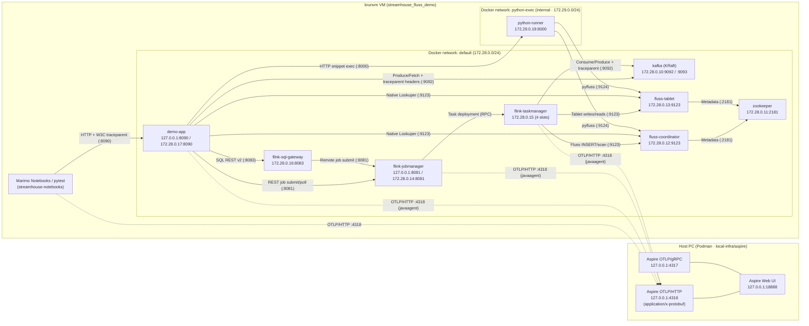
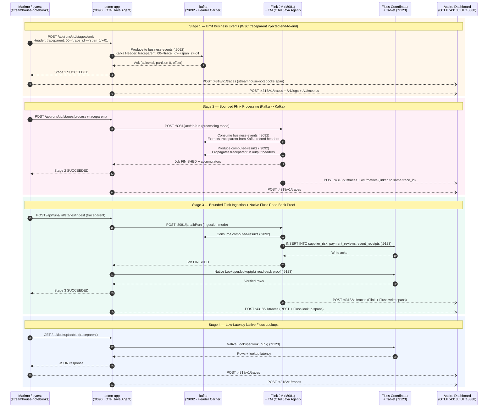

# Observability Architecture (OpenTelemetry + Aspire Dashboard)

This document explains how services in the **Payment Risk Streamhouse Demo** (`notebooks/`, `demo-app`, Kafka, Flink, Fluss, and `python-runner`) emit, propagate, and expose OpenTelemetry (OTel) telemetry to the standalone **.NET Aspire Dashboard** running from `local-infra/aspire`.

For the underlying container-to-container data-plane architecture, see [architecture.md](./architecture.md).

---

## 1. Host & VM Topology Overview

The Aspire Dashboard runs on the **host PC** via `local-infra/aspire/scripts/run_aspire.sh` (using `podman compose`, with fallback to `podman-compose` and `docker compose`) in `network_mode: host` with a lightweight footprint (~40–100 MiB RAM, capped at `256m`). The Streamhouse stack runs inside the `krunvm` VM and forwards OTLP/HTTP Protobuf telemetry to `http://127.0.0.1:4318`.



### 1.1 Host ↔ VM Sequence

This sequence shows how the host and the `krunvm` VM interact. It covers starting Aspire on the host, sending telemetry from the VM through krunvm's socket passthrough (TSI) to the host loopback, and viewing it in the browser. It also shows the VS Code Remote-SSH auto-forward conflict that can block Aspire's ports.

```mermaid
sequenceDiagram
    autonumber

    actor Dev as Developer
    participant Run as run_aspire.sh<br/>(Host)
    participant Podman as Podman<br/>(Host · rootless)
    participant Aspire as Aspire Dashboard<br/>(network_mode: host)
    participant Loop as Host loopback<br/>127.0.0.1
    participant VSC as VS Code (Flatpak)<br/>Remote-SSH
    participant VM as krunvm VM<br/>(krun-act-runner · TSI)
    participant Svc as Streamhouse services<br/>(notebooks · demo-app · Flink)

    %% Preflight & startup
    rect rgba(59, 130, 246, 0.08)
        Note over Dev,Aspire: Startup on the host
        Dev->>Run: bash scripts/run_aspire.sh
        Run->>Run: Load aspire/.env, detect Compose CLI
        Run->>Loop: Preflight check (ss) for :18888 / :4317 / :4318
        alt Port held by another process (e.g. VS Code forward)
            Loop-->>Run: LISTEN owned by "code" / HyperDX
            Run-->>Dev: ERROR + hint, stop container, exit 1
        else Ports free
            Run->>Podman: compose up -d (--force-recreate if hash changed)
            Podman->>Aspire: Start mcr.microsoft.com/dotnet/aspire-dashboard:9.0
            Aspire->>Loop: Bind :18888 (UI), :4317 (gRPC), :4318 (HTTP)
            Run->>Loop: Poll GET :18888 and POST :4318/v1/traces
            Loop-->>Run: HTTP 200 / 200
            Run-->>Dev: Aspire Dashboard Running
        end
    end

    %% Port-forward conflict
    rect rgba(239, 68, 68, 0.08)
        Note over VSC,VM: Known conflict: VS Code auto-forward
        VSC->>VM: Remote-SSH session (detects listener on :4318 in remote)
        VSC->>Loop: Auto-forward → bind 127.0.0.1:4318 on host
        Note over Aspire,Loop: Aspire then crash-loops with<br/>"address already in use"<br/>Fix: remote.portsAttributes onAutoForward=ignore<br/>for 4317 / 4318 / 18888 (chezmoi settings.json)
    end

    %% Telemetry path
    rect rgba(16, 185, 129, 0.08)
        Note over Svc,Aspire: Telemetry from the VM to the host
        Svc->>VM: OTLP/HTTP POST 127.0.0.1:4318/v1/traces|logs|metrics
        VM->>Loop: TSI proxies guest socket to host loopback :4318
        Loop->>Aspire: Deliver OTLP (application/x-protobuf)
        Aspire-->>Loop: HTTP 200
        Loop-->>VM: HTTP 200
        VM-->>Svc: HTTP 200
    end

    %% Viewing
    rect rgba(245, 158, 11, 0.08)
        Note over Dev,Aspire: Inspect telemetry
        Dev->>Loop: Browser → http://127.0.0.1:18888
        Loop->>Aspire: UI request
        Aspire-->>Dev: Traces, structured logs, metrics
    end
```

---

## 2. Port Reference

### Aspire Dashboard (`local-infra/aspire`, Host PC)

Configured via `local-infra/aspire/.env` (from `.env.example`) and launched with `local-infra/aspire/scripts/run_aspire.sh`:

| Endpoint | Default Bind / Port | Protocol | Purpose |
| --- | --- | --- | --- |
| **Aspire Web UI** | `127.0.0.1:18888` | HTTP (`/` → `/structuredlogs`) | Interactive UI for distributed trace waterfalls, structured logs, and metrics |
| **OTLP HTTP Receiver** | `127.0.0.1:4318` | HTTP/1.1 (`application/x-protobuf`) | Primary ingest endpoint (`POST /v1/traces`, `POST /v1/logs`, `POST /v1/metrics`) |
| **OTLP gRPC Receiver** | `127.0.0.1:4317` | gRPC (HTTP/2) | Alternative OTLP/gRPC ingest endpoint |

> **Protocol Note:** `mcr.microsoft.com/dotnet/aspire-dashboard:9.0` accepts **`Content-Type: application/x-protobuf`** on `:4318` (returning `HTTP 200`) and rejects `application/json` with `HTTP 415`. Both Python `opentelemetry-exporter-otlp-proto-http` and the Java `opentelemetry-javaagent` use `http/protobuf` by default.

### Streamhouse Services (`streamhouse_fluss_demo`, `krunvm` VM)

| Service | Host-Published Port(s) | Internal Compose Address & Port(s) | Telemetry Role |
| --- | --- | --- | --- |
| **`notebooks/`** (Marimo / `pytest`) | Local process | Calls `127.0.0.1:8090` | **Active OTLP emitter** (`streamhouse-notebooks`) — starts root spans, injects W3C `traceparent` into HTTP requests |
| **`demo-app`** | `127.0.0.1:8090` (optional JDWP `:5005`) | `172.28.0.17:8090` (`default`), `172.29.0.17:8090` (`python-exec`) | **Active OTLP emitter** (`demo-app`) — zero-code `opentelemetry-javaagent` traces HTTP, Kafka producer, Flink REST, SQL Gateway, Fluss lookups, and JVM metrics |
| **`kafka`** | None | `172.28.0.10:9092` (`PLAINTEXT`), `:9093` (`CONTROLLER`) | **Context carrier** — durably carries W3C `traceparent` in Kafka record headers between `demo-app` and Flink |
| **`flink-jobmanager`** | `127.0.0.1:8081` | `172.28.0.14:8081` (REST/UI), internal RPC/BlobServer | **Active OTLP emitter** (`flink-jobmanager`) — traces job submission, lifecycle, and JVM metrics |
| **`flink-taskmanager`** | None (optional JDWP `:5006`) | `172.28.0.15` (4 task slots) | **Active OTLP emitter** (`flink-taskmanager`) — traces Kafka consumer/producer spans linked to `trace_id` and Fluss sink writes |
| **`flink-sql-gateway`** | None | `172.28.0.16:8083` (REST v2) | **Client-observed** — traced from `demo-app` HTTP client spans; submits remote jobs to `flink-jobmanager:8081` |
| **`fluss-coordinator`** | None | `172.28.0.12:9123` (`FLUSS`), `172.29.0.12:9124` (`PYEXEC`) | **Client-observed** — observed via `demo-app` and `flink-taskmanager` client spans |
| **`fluss-tablet`** | None | `172.28.0.13:9123` (`FLUSS`), `172.29.0.13:9124` (`PYEXEC`) | **Client-observed** — observed via Stage 3 writes (`flink-taskmanager`) and Stage 3/4 native `Lookuper` reads (`demo-app`) |
| **`zookeeper`** | None | `172.28.0.11:2181` | **Internal infrastructure** — Fluss metadata coordination only (not instrumented directly) |
| **`python-runner`** | None | `172.29.0.19:8000` (`python-exec`, `internal: true`) | **Air-gapped / client-observed** — cannot reach `:4318` by design; traced at the `demo-app` → `python-runner:8000` boundary |

---

## 3. Service Interactions with Aspire Dashboard

The sequence diagram below shows how a single end-to-end run (`Stage 1 → Stage 4`) produces a connected distributed trace waterfall inside Aspire Dashboard (`http://127.0.0.1:18888`) while keeping every REST API contract unchanged.



---

## 4. Starting & Verifying Aspire (`local-infra/aspire/scripts/run_aspire.sh`)

### Step 1: Start Aspire Dashboard on the Host PC

```bash
cd /local-infra/aspire
cp .env.example .env
bash scripts/run_aspire.sh
bash scripts/test_aspire.sh
```

What `run_aspire.sh` does:
1. Loads and validates all required SSOT variables from `aspire/.env` (`ASPIRE_LISTEN_IP`, `ASPIRE_CONNECT_IP`, `ASPIRE_UI_PORT`, `ASPIRE_OTLP_GRPC_PORT`, `ASPIRE_OTLP_HTTP_PORT`, `ASPIRE_MEM_LIMIT`, `TZ`).
2. Auto-detects the container Compose CLI in strict priority order: **`podman compose` → `podman-compose` → `docker compose`**.
3. Computes a SHA-256 hash of `docker-compose.yaml` + `.env` (`.compose.sha256`) and only passes `--force-recreate` when configuration changes.
4. Waits until both the Web UI (`http://127.0.0.1:18888`) and the OTLP/HTTP receiver (`POST http://127.0.0.1:4318/v1/traces` with `Content-Type: application/x-protobuf`) return `HTTP 200`.

### Step 2: Verify VM → Host OTLP Reachability

From inside the `krunvm` VM:

```bash
curl -s -o /dev/null -w "%{http_code}\n" \
  -X POST \
  -H "Content-Type: application/x-protobuf" \
  --data-binary "" \
  http://127.0.0.1:4318/v1/traces
# Expected: 200
```

Then open **http://127.0.0.1:18888** in your host browser to inspect incoming **Traces**, **Structured Logs**, and **Metrics**.

### Step 3: Client OTel Environment Variables

All instrumented Streamhouse components (Marimo notebooks, `demo-app`, `flink-jobmanager`, `flink-taskmanager`) use the same standard OTel variables:

```env
OTEL_EXPORTER_OTLP_ENDPOINT=http://127.0.0.1:4318
OTEL_EXPORTER_OTLP_PROTOCOL=http/protobuf
OTEL_EXPORTER_OTLP_HEADERS=
```

---

## 5. Switching Between Aspire and HyperDX

Both `local-infra/aspire` (`~40–100 MiB`, Web UI `:18888`) and `local-infra/hyperdx` (`~2–3.5 GiB`, Web UI `:8088`) intentionally bind the same OTLP ports (`:4317` and `:4318`).

- Run **only one** OTLP collector on the host at a time.
- Because both share `:4318`, switching between Aspire (daily lightweight dev) and HyperDX (persistent ClickHouse analytics) requires **zero changes** to `streamhouse_fluss_demo`.
